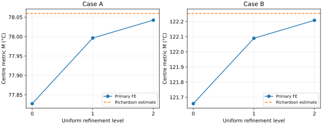

# Independent steady-state FE comparison

The input is the configured TAP-2.5D package, at reference commit `af66bcfc21220ce3d8e92e89273979241e54b04a`. Temperatures below are computed with conforming P1 tetrahedral FE. The primary metric is the maximum die-centre temperature at the chip mid-plane with uniform volumetric power.

The paper uses a different HotSpot block/cell selector. Differences here are numerical comparisons of the configured model, not silicon validation.

| Case | Primary M (°C) | Die | Paper (°C) | M − paper (K) | S mid-plane M (°C) |
|---|---:|---|---:|---:|---:|
| A | 78.042335 | Chiplet_0 | 75.48 | +2.562335 | 78.144892 |
| B | 122.207837 | Chiplet_0 | 115.94 | +6.267837 | 122.572129 |

## Method and reproducibility

The weak form is ∫ k ∇θ·∇v dV + ∫top h θ v dA = ∫ q v dV, with θ=T−318.15 K. Variant S replaces the volume term with a single internal die-bottom sheet load. Shared nodes impose perfect contact; all other exterior faces are natural zero-flux boundaries. Exact element integration is used for diffusion, volume loads, sheet loads and the consistent Robin matrix.

Every box is split into six Kuhn tetrahedra. All block edges and all layer interfaces conform to the mesh. Floating duplicates within 2e−16 m are merged; the 5.1 µm A gap is retained and filled with k=1.6 W/(m K). Meshes halve every x/y/z interval, including thin layers and halos. The listed minimum size is the shortest edge, and the maximum is the largest tetrahedron diameter. Centre points are nodes at every level. Horizontal cell means are integrated exactly by clipping the P1 pieces against the requested rectangles.

Classical Ruge–Stuben AMG preconditions conjugate gradients (relative tolerance 1e−10). The reported residual is ||Kθ−f||₂/||f||₂. Assembly and primary solver times include AMG setup where applicable; S reuses the same matrix and preconditioner. Peak RSS is measured in a fresh process per case/mesh; the S measurement includes the primary run high-water mark.

Run `python fe/run_study.py` with the pinned dependencies in `fe/requirements.txt`. It verifies the original four-file manifest, regenerates all six meshes and eight solutions, and writes these tables, the plot, JSON outputs and an output SHA256 manifest. Timing/RSS and platform strings vary by machine; numeric fields should reproduce within solver tolerance. The full command and validation instructions are in [../README.md](../README.md).

Input SHA256: `b01b4a33c530db309889b8ad9feda96701ca5a7b9cb4b17562a6750a08b0805a`. Script SHA256: `d77663f7f3e22bf1980bd9d3846d1ba5c9971b23d11c85b654859ce9e2e8dd52`.

## Convergence

The estimate uses the last three nested meshes: p=log₂(|Δcoarse/Δfine|), M∞=Mfine+Δfine/(2ᵖ−1), and absolute GCI=1.25|M∞−Mfine|. It is an asymptotic estimate, not a rigorous bound. No estimate is accepted for oscillating differences or a changing maximizing die.

| Case | Observed p | Extrapolated M (°C) | Absolute GCI (K) | ≤0.1 K aim |
|---|---:|---:|---:|---|
| A | 1.8786 | 78.059506 | 0.021463 | met |
| B | 1.8627 | 122.252812 | 0.056218 | met |

## Case A

| Mesh | P1 tetrahedra | DOFs | Min edge (m) | Max diameter (m) | M (°C) | Residual | Solver s | Peak MiB |
|---|---:|---:|---:|---:|---:|---:|---:|---:|
| m0 primary | 127,896 | 24,472 | 5.1e-06 | 0.01595 | 77.827317 | 8.75e-11 | 0.435 | 80.5 |
| m1 primary | 1,023,168 | 182,943 | 2.55e-06 | 0.007976 | 77.996365 | 7.04e-11 | 2.003 | 153.4 |
| m2 primary | 8,185,344 | 1,413,469 | 1.275e-06 | 0.003988 | 78.042335 | 9.31e-11 | 21.371 | 763.4 |
| m2 S | 8,185,344 | 1,413,469 | 1.275e-06 | 0.003988 | 78.144892 | 6.29e-11 | 17.997 | 775.0 |

Through-layer interval counts (L0…L7): m0 = [1, 1, 1, 1, 2, 1, 2, 6]; m1 = [2, 2, 2, 2, 4, 2, 4, 12]; m2 = [4, 4, 4, 4, 8, 4, 8, 24].

Finest-mesh die temperatures below are °C; `study.json` also contains Kelvin values, every mesh, all L0–L5 block cell averages, and extrema with coordinates.

| Source | Die | Bottom | Mid | Top | L4 HotSpot-cell mean |
|---|---|---:|---:|---:|---:|
| primary | Chiplet_0 | 78.145458 | 78.042335 | 77.729337 | 78.025081 |
| primary | Chiplet_1 | 61.395087 | 61.379480 | 61.332629 | 61.146418 |
| primary | Chiplet_2 | 66.353552 | 66.313974 | 66.193209 | 66.285759 |
| primary | Chiplet_3 | 67.671533 | 67.631339 | 67.509936 | 67.767833 |
| primary | Chiplet_4 | 66.498459 | 66.458331 | 66.336984 | 66.430631 |
| primary | Chiplet_5 | 67.836278 | 67.795537 | 67.673552 | 67.936370 |
| S | Chiplet_0 | 78.563684 | 78.144892 | 77.727077 | 78.127627 |
| S | Chiplet_1 | 61.457814 | 61.395331 | 61.332854 | 61.162209 |
| S | Chiplet_2 | 66.516200 | 66.354159 | 66.192458 | 66.325992 |
| S | Chiplet_3 | 67.833505 | 67.671388 | 67.509587 | 67.807992 |
| S | Chiplet_4 | 66.660739 | 66.498603 | 66.336776 | 66.470958 |
| S | Chiplet_5 | 67.997890 | 67.835676 | 67.673745 | 67.976628 |

| Source | Plane | Max die-centre (°C) | Difference from paper (K) |
|---|---|---:|---:|
| primary | bottom | 78.145458 | +2.665458 |
| primary | mid | 78.042335 | +2.562335 |
| primary | top | 77.729337 | +2.249337 |
| S | bottom | 78.563684 | +3.083684 |
| S | mid | 78.144892 | +2.664892 |
| S | top | 77.727077 | +2.247077 |

| Source | Input W | Convective W | Relative imbalance | Mean top excess K |
|---|---:|---:|---:|---:|
| primary | 350.000000000 | 350.000000000 | 9.81e-13 | 3.888888889 |
| S | 350.000000000 | 350.000000000 | 2.46e-13 | 3.888888889 |

| Source | Global min (°C), (x,y,z) m | Global max (°C), (x,y,z) m | L3/L4 cell selector (°C) |
|---|---|---|---|
| primary | 45.868788, (0.1125, 0.1125, 0.00846) | 78.145458, (0.0171501, 0.0226003, 0.00039) | 78.127852, L3/Chiplet_0 |
| S | 45.868802, (0.1125, 0.1125, 0.00846) | 78.563684, (0.0171501, 0.0226003, 0.00039) | 78.546283, L3/Chiplet_0 |

| Layer | Primary field max °C | S field max °C |
|---|---:|---:|
| L0 | 78.142798 | 78.561087 |
| L1 | 78.143246 | 78.561524 |
| L2 | 78.145202 | 78.563433 |
| L3 | 78.145458 | 78.563684 |
| L4 | 78.145458 | 78.563684 |
| L5 | 77.729337 | 77.727077 |
| L6 | 74.947563 | 74.944911 |
| L7 | 73.642907 | 73.640222 |

## Case B

| Mesh | P1 tetrahedra | DOFs | Min edge (m) | Max diameter (m) | M (°C) | Residual | Solver s | Peak MiB |
|---|---:|---:|---:|---:|---:|---:|---:|---:|
| m0 primary | 135,066 | 25,792 | 1e-05 | 0.01595 | 121.657927 | 8e-11 | 0.529 | 81.7 |
| m1 primary | 1,080,528 | 192,999 | 5e-06 | 0.007976 | 122.089243 | 7.66e-11 | 2.589 | 162.7 |
| m2 primary | 8,644,224 | 1,491,925 | 2.5e-06 | 0.003988 | 122.207837 | 9.04e-11 | 17.959 | 804.4 |
| m2 S | 8,644,224 | 1,491,925 | 2.5e-06 | 0.003988 | 122.572129 | 7.1e-11 | 14.385 | 816.4 |

Through-layer interval counts (L0…L7): m0 = [1, 1, 1, 1, 2, 1, 2, 6]; m1 = [2, 2, 2, 2, 4, 2, 4, 12]; m2 = [4, 4, 4, 4, 8, 4, 8, 24].

Finest-mesh die temperatures below are °C; `study.json` also contains Kelvin values, every mesh, all L0–L5 block cell averages, and extrema with coordinates.

| Source | Die | Bottom | Mid | Top | L4 HotSpot-cell mean |
|---|---|---:|---:|---:|---:|
| primary | Chiplet_0 | 122.569999 | 122.207837 | 121.093658 | 122.178313 |
| primary | Chiplet_1 | 122.568140 | 122.205979 | 121.091802 | 122.174354 |
| primary | Chiplet_2 | 122.569551 | 122.207390 | 121.093213 | 122.176948 |
| primary | Chiplet_3 | 122.567824 | 122.205664 | 121.091487 | 122.173122 |
| primary | Chiplet_4 | 86.195486 | 86.146995 | 86.000708 | 85.902928 |
| primary | Chiplet_5 | 86.192971 | 86.144482 | 85.998198 | 85.897714 |
| primary | Chiplet_6 | 86.195333 | 86.146843 | 86.000557 | 85.902351 |
| primary | Chiplet_7 | 86.193316 | 86.144825 | 85.998540 | 85.897633 |
| S | Chiplet_0 | 124.070604 | 122.572129 | 121.079230 | 122.542423 |
| S | Chiplet_1 | 124.068738 | 122.570264 | 121.077366 | 122.538455 |
| S | Chiplet_2 | 124.070144 | 122.571670 | 121.078772 | 122.541044 |
| S | Chiplet_3 | 124.068426 | 122.569953 | 121.077056 | 122.537226 |
| S | Chiplet_4 | 86.391464 | 86.196032 | 86.000764 | 85.951872 |
| S | Chiplet_5 | 86.388931 | 86.193501 | 85.998235 | 85.946642 |
| S | Chiplet_6 | 86.391287 | 86.195856 | 86.000588 | 85.951273 |
| S | Chiplet_7 | 86.389289 | 86.193858 | 85.998591 | 85.946572 |

| Source | Plane | Max die-centre (°C) | Difference from paper (K) |
|---|---|---:|---:|
| primary | bottom | 122.569999 | +6.629999 |
| primary | mid | 122.207837 | +6.267837 |
| primary | top | 121.093658 | +5.153658 |
| S | bottom | 124.070604 | +8.130604 |
| S | mid | 122.572129 | +6.632129 |
| S | top | 121.079230 | +5.139230 |

| Source | Input W | Convective W | Relative imbalance | Mean top excess K |
|---|---:|---:|---:|---:|
| primary | 680.000000000 | 679.999999991 | -1.27e-11 | 7.555555555 |
| S | 680.000000000 | 679.999999991 | -1.3e-11 | 7.555555555 |

| Source | Global min (°C), (x,y,z) m | Global max (°C), (x,y,z) m | L3/L4 cell selector (°C) |
|---|---|---|---|
| primary | 46.874943, (-0.0675, -0.0675, 0.00846) | 125.827220, (0.0199874, 0.020283975, 0.00039) | 122.539537, L3/Chiplet_0 |
| S | 46.874969, (-0.0675, -0.0675, 0.00846) | 127.313564, (0.0199874, 0.020283975, 0.00039) | 124.039950, L3/Chiplet_0 |

| Layer | Primary field max °C | S field max °C |
|---|---:|---:|
| L0 | 125.799028 | 127.284485 |
| L1 | 125.803790 | 127.289398 |
| L2 | 125.824510 | 127.310769 |
| L3 | 125.827220 | 127.313564 |
| L4 | 125.827220 | 127.313564 |
| L5 | 124.384866 | 124.358291 |
| L6 | 114.636535 | 114.617721 |
| L7 | 110.434289 | 110.424514 |

## Environment and limits

- python: `3.12.3`
- numpy: `2.5.4`
- scipy: `1.18.1`
- scikit-fem: `12.0.2`
- pyamg: `5.4.1`
- mesher: `rectilinear Kuhn tetrahedra v1 (fe/solver.py)`
- os: `Linux-7.0.0-1017-azure-x86_64-with-glibc2.39`
- cpu: `AMD EPYC 7763 64-Core Processor`
- architecture: `x86_64`
- worker_threads: `{'OPENBLAS_NUM_THREADS': '1', 'OMP_NUM_THREADS': '1'}`

scikit-fem provides the independent assembly oracle in the tests; production assembly uses the algebraically identical compressed P1 element contributions. The mesher is the versioned Python implementation in `fe/solver.py`.

The GCI estimates concern the primary centre metric. S is computed on the finest mesh only; it has no separate convergence estimate. Field extrema and cell selectors are different metrics and do not inherit the primary metric error estimate. The paper solver tolerance/build, exact layout-to-figure fidelity and the full HotSpot package-node selector are not reproduced. Decoded coordinate uncertainty is not propagated. No comparison to withheld evaluator values is made.

## Attribution

Inputs: SentiLab reference case (CC BY 4.0), preserving its LICENSE and provenance. Paper: Y. Ma et al., “TAP-2.5D: A Thermally-Aware Chiplet Placement Methodology for 2.5D Systems”, DATE 2021, pp. 1246–1251, doi:10.23919/DATE51398.2021.9474011. TAP-2.5D and HotSpot retain their own licences; no source from either solver is vendored.
